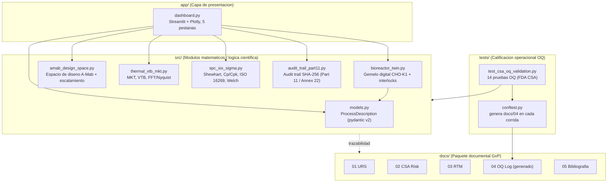

 [](https://bioprocesos-project.streamlit.app/)

# bioprocesos-PROJECT

**🌐 Live Interactive SCADA & GxP Dashboard:** [https://bioprocesos-project.streamlit.app/](https://bioprocesos-project.streamlit.app/)

Portafolio de bioprocesos, control y validacion GxP de **Alejandro Timaran**, estudiante de **Ingenieria Biologica** de la **Universidad Nacional de Colombia (UNAL)**, perteneciente a ISPE.

## Descripcion ejecutiva

Este repositorio reune un conjunto de modulos cientificos en Python que modelan y validan, de extremo a extremo, un sistema de control de biorreactor para cultivo de celulas CHO-K1, siguiendo marcos regulatorios reales (FDA CSA 2026, ISPE GAMP 5, ICH Q8-Q12, 21 CFR Part 11, EU GMP Annex 11/22, ASME BPE-2014, ISO 16269-6, USP). El portafolio integra:

- Un **gemelo digital mecanistico** fed-batch CHO-K1 con receta estatica y lazo cerrado adaptativo (base Bionova Scientific / Ark Biotech 2026).
- La evaluacion del **espacio de diseno multivariado A-Mab** (ISPE 2009) y el escalamiento de transferencia de oxigeno (kLa, OUR) de 2 L a 15,000 L.
- Analitica termica de cadena de frio: **MKT**, **buffer termico virtual (VTB)** y verificacion de muestreo por **FFT/Nyquist** (Rusnack, Pharm. Eng. 2026).
- Control estadistico de procesos **Six Sigma** (cartas de Shewhart, capacidad Cp/Cpk, intervalos de tolerancia ISO 16269, prueba t de Welch) sobre los datasets de Gorsky (2020).
- Una **traza de auditoria encadenada por SHA-256** conforme a 21 CFR Part 11 y al guardarail humano-en-el-lazo del EU GMP Annex 22.

Todo esto se expone en un **tablero interactivo de Streamlit + Plotly** (`app/dashboard.py`) con 5 pestanas, respaldado por una **suite de calificacion operacional (OQ)** en pytest que genera automaticamente un log de ejecucion GxP.

## Arquitectura



## Modulos matematicos (src/)

| Modulo | Responsabilidad |
| --- | --- |
| `models.py` | Esquema `ProcessDescription` (pydantic v2) con los parametros criticos del proceso (CPP) y sus limites validados: volumen, P/V, sparge, temperaturas, dia de cambio termico, pH, DO, umbrales de glucosa, duracion y modo (`static` / `closed_loop`). |
| `bioreactor_twin.py` | Gemelo digital mecanistico CHO-K1 fed-batch: `simulate_cho_fed_batch` (VCD, viabilidad, glucosa, lactato, titulo), controlador split-range de pH `compute_split_range_ph_actuators`, programa de cambio termico `get_temperature_setpoint` e interlocks de seguridad `check_safety_interlocks` (cizalla hidrodinamica, CIP con velocidad ASME BPE 1.52 m/s, SIP con integral de letalidad F0). |
| `amab_design_space.py` | `evaluate_amab_design_space`: superficies de respuesta de las 4 CQA de N-glicano (z1..z4) y verificacion del espacio de diseno A-Mab; `compute_scale_up_engineering`: correlacion de kLa y OUR para escalamiento de oxigeno. |
| `thermal_vtb_mkt.py` | `calculate_mkt_celsius` (temperatura cinetica media, Arrhenius), `apply_vtb_filter` (buffer termico virtual de primer orden por volumen) y `analyze_fft_nyquist` (limite de Nyquist, frecuencia dominante, riesgo de aliasing). Incluye `VTB_CALIBRATION_TABLE`. |
| `spc_six_sigma.py` | `compute_process_capability` (Cp/Cpu/Cpl/Cpk, UCL/LCL), `compute_iso16269_tolerance_interval` (intervalo de tolerancia ISO 16269-6) y `compare_bioreactor_equivalence_ttest` (prueba t de Welch). Datasets de torque de Gorsky (`GORSKY_TABLE_6_1_TORQUE_N10`, `GORSKY_TABLE_6_2_TORQUE_N30`). |
| `audit_trail_part11.py` | `AuditTrailLogger`: traza de auditoria encadenada por SHA-256 a prueba de manipulacion, con aprobacion humana obligatoria (Annex 22) y razon de cambio documentada (Part 11); `verify_chain_integrity` detecta cualquier alteracion. |

## Documentos GxP (docs/)

| Documento | Descripcion |
| --- | --- |
| `docs/01_URS_Bioreactor_Control_System.md` | Especificacion de requisitos de usuario (URS) del sistema de control del biorreactor. |
| `docs/02_FDA_CSA_Risk_Assessment_2026.md` | Evaluacion de riesgo bajo la guia FDA Computer Software Assurance (CSA) 2026. |
| `docs/03_RTM_Traceability_Matrix.md` | Matriz de trazabilidad de requisitos (RTM) que vincula URS, riesgo y pruebas. |
| `docs/04_Automated_OQ_Execution_Log.md` | Log de ejecucion de la calificacion operacional (OQ). **Generado automaticamente** por `tests/conftest.py` en cada corrida de pytest (no editar a mano). |
| `docs/05_Academic_and_Regulatory_Bibliography.md` | Bibliografia academica, industrial y regulatoria de respaldo. |

## Instalacion

```bash
python -m venv .venv
. .venv/bin/activate
pip install -r requirements.txt
```

## Ejecucion

Correr la suite de calificacion operacional (OQ) desde la raiz del repositorio (regenera `docs/04_Automated_OQ_Execution_Log.md`):

```bash
python -m pytest -v
```

Lanzar el tablero interactivo:

```bash
streamlit run app/dashboard.py
```

## Nota de calibracion del gemelo digital

Los resultados del gemelo digital (14 d, parametros por defecto, v1.2.0) son **valores medidos, no forzados**: son la salida directa de las ecuaciones de `simulate_cho_fed_batch`. Los dos modos usan la **misma ley cinetica** (mu, kd y qp dependen solo de G, L, T, Xv y la cizalla); `mode` solo decide la dosificacion de los bolos. La diferencia entre modos sale de la alimentacion y de las trayectorias G(t) y L(t).

| Escala (vessel_volume_L) | Modo | Titulo final (g/L) | Viabilidad final (%) | Masa cosechada (g) | V0 / Vfinal (L) | Volumen alimentado (L) | min / max G (g/L) | max / final L (g/L) |
| --- | --- | --- | --- | --- | --- | --- | --- | --- |
| 0.25 L | static | 1.0164 | 81.17 | 0.2466 | 0.1900 / 0.2427 | 0.0527 | 0.0057 / 6.0000 | 1.0889 / 1.0783 |
| 0.25 L | closed_loop | 1.1654 | 91.56 | 0.3048 | 0.1900 / 0.2615 | 0.0715 | 0.7241 / 6.0000 | 1.0001 / 0.6498 |
| 2.0 L | static | 1.0164 | 81.17 | 1.9731 | 1.5200 / 1.9413 | 0.4213 | 0.0057 / 6.0000 | 1.0889 / 1.0783 |
| 2.0 L | closed_loop | 1.1654 | 91.56 | 2.4384 | 1.5200 / 2.0923 | 0.5723 | 0.7241 / 6.0000 | 1.0001 / 0.6498 |

- **Ganancia emergente de titulo (closed_loop vs static): +14.66 %** en ambas escalas. Ganancia de masa cosechada: +23.60 % (0.25 L) y +23.58 % (2.0 L); la masa crece mas que el titulo porque el lazo cerrado anade volumen con la reposicion de glucosa.
- En lazo cerrado la glucosa baja de 2.0 g/L antes de los bolos de los dias 6, 8 y 12, la reposicion adaptativa (V_gluc > 0) la devuelve a 5.0 g/L, y el cultivo entra en la ventana de consumo neto de lactato (2.0 <= G <= 5.0 g/L, t >= 6 d): el lactato baja de su pico de 1.0001 g/L a 0.6498 g/L. En la receta estatica la glucosa se agota desde el dia 7 y la muerte por inanicion reduce la viabilidad final.
- Escalamiento A-Mab: **kLa = 20.0 h^-1** a 15,000 L (Vs = 0.015 m/s, P/V = 26 W/m3; **OTR = 2.94 mmol/L/h**); rango **11.10-21.84 h^-1** para Vs = 0.005-0.017 m/s y P/V = 19-30 W/m3.
- Six Sigma (Gorsky Tabla 6.2, n=30, lb/in): **Ppk 0.51**, **Cpk(within) 0.43**, **Shapiro-Wilk p = 0.243**; intervalo de tolerancia ISO 16269-6 (Tabla 6.1, n=10, kp) con **k_factor 3.394**.
- Calificacion operacional: **14/14 pruebas OQ** aprobadas.

La ganancia de +14.66 % es menor que el +43 % que reporta el boletin de Ark Biotech (Quint et al., 2026). El modelo no se calibra para reproducir ese valor: las constantes de muerte celular (KD_STARVE, KD_LAC) son supuestos del modelo y deben ajustarse con datos experimentales de viabilidad antes de usar la ganancia como prediccion. En el tablero la **ganancia de titulo se calcula en vivo** a partir de la simulacion y nunca se fija como constante.

## Seccion 5: Bibliografia Academica, Industrial y Regulatoria
Referencias Bibliográficas y Marco Regulatorio (References)

A. Modelamiento de Bioprocesos, Escalamiento, QbD y Gemelos Digitales
1. CMC Biotech Working Group (Pfizer, Amgen, Genentech, Eli Lilly, GSK, Abbott, MedImmune), A-Mab: A Case Study in Bioprocess Development, Version 2.1, CASSS and International Society for Pharmaceutical Engineering (ISPE), Oct. 2009.
2. R. Kulkarni, C. Horner, J.-M. Guedon, Y. Zahra, C. Edington, and M. Aswath, "STRATYX™ Delivers Superior Viable Cell Density and Increased mAb Titer Compared with Conventional 250 mL Bioreactors in Fed-Batch CHO Culture," Culture Biosciences & Bionova Scientific Whitepaper, 2026.
3. Y. Quint, H. Worssam, C. Horner, and M. Khor, "Real-Time Closed-Loop Optimization Delivers 43% Titer Improvement Over Historical Best," Ark Biotech & Culture Biosciences Technical Bulletin, 2026.
4. H. Dahodwala et al., "Development and Characterization of the NISTCHO Reference Cell Line," Biotechnology Journal, vol. 20, no. 5, e70012, May 2025, doi: 10.1002/biot.70012.
5. D. M. Marks, "Best Practices for Bioreactor Contamination Investigations," Pharmaceutical Engineering (ISPE), vol. 46, no. 5, pp. 67–71, Sep./Oct. 2026.
6. N. K. Ma et al., "Fabrication and use of a transient contraction flow device to quantify the sensitivity of mammalian and insect cells to hydrodynamic forces," Biotechnology and Bioengineering, vol. 80, pp. 428–436, 2002.
7. V. Warikoo et al., "Integrated continuous production of recombinant therapeutic proteins," Biotechnology and Bioengineering, vol. 109, no. 12, pp. 3018–3029, 2012.
8. M.-F. Clincke et al., "Very high density of CHO cells in perfusion by alternating tangential flow or tangential flow filtration in wave bioreactor™—Part I: Effect of the cell density on the process," Biotechnology Progress, vol. 29, no. 3, 2013.

B. Estadística de Validación de Procesos, Seis Sigma y Confiabilidad Bayesiana

9. I. Gorsky, "Chapter 6: Use of Statistics in Process Validation," in Principles of Parenteral Solution Validation, Elsevier Inc., 2020, pp. 115–136, doi: 10.1016/B978-0-12-809412-9.00005-8.
10. J. J. Peterson, "A Bayesian Approach to the ICH Q8 Definition of Design Space," Journal of Biopharmaceutical Statistics, vol. 18, no. 5, pp. 959–975, 2008.
11. G. C. Stockdale and A. Cheng, "Finding design space and a reliable operating region using a multivariate Bayesian approach with experimental design," Quality Technology and Quantitative Management, vol. 6, no. 4, pp. 391–408, 2009.
12. ISO 16269-6:2014, Statistical interpretation of data — Part 6: Determination of statistical tolerance intervals, International Organization for Standardization, Geneva, 2014.
13. ASTM E2281, Standard Practice for Process and Measurement Capability Indices, ASTM International, West Conshohocken, PA.

C. Termodinámica de Cadena de Frío, MKT, Procesamiento de Señales y Calidad 4.0

14. M. Rusnack, "Quantifying the Limitations of Fixed Physical Temperature Buffers," Pharmaceutical Engineering (ISPE), vol. 46, no. 5, pp. 54–66, Sep./Oct. 2026. Datasets: Zenodo, doi: 10.5281/zenodo.15871349 and doi: 10.5281/zenodo.20788524.
15. R. Dream, "Quality 4.0: Part 1 — Quality Management Principles and Benefits," Pharmaceutical Engineering (ISPE), vol. 46, no. 5, pp. 12–17, Sep./Oct. 2026.
16. G. Kantor, "Effective Sampling in Pharmaceutical Utility Systems (ISPE Good Practice Guide & USP <1231>)," Pharmaceutical Engineering (ISPE), vol. 46, no. 5, p. 47, Sep./Oct. 2026.

D. Guías Regulatorias, Validación de Sistemas Computarizados (CSA/GAMP 5) y Diseño Higiénico

17. U.S. Food and Drug Administration (FDA), Computer Software Assurance for Production and Quality Management System Software: Guidance for Industry and Food and Drug Administration Staff, CDRH/CBER/CDER, Feb. 3, 2026.
18. ISPE, GAMP® 5 Guide: A Risk-Based Approach to Compliant GxP Computerized Systems, 2nd ed., North Bethesda, MD: International Society for Pharmaceutical Engineering, 2022; and ISPE Baseline® Guide, Vol. 8: Pharma 4.0™, 2023.
19. ASME BPE-2014, Bioprocessing Equipment: An International Standard, The American Society of Mechanical Engineers, New York, NY, 2014.
20. European Commission / EMA & FDA, EudraLex Volume 4, Annex 11 (Computerized Systems) & Draft Annex 22 (Artificial Intelligence); ICH Harmonised Guidelines Q8(R2), Q9(R1), Q10, Q11, Q12; and Ministerio de Salud y Protección Social de Colombia, Decreto 1782 de 2014 (evaluación farmacológica y farmacéutica de medicamentos biológicos) y Resolución 1160 de 2016 (BPM Farmacéuticas / OMS Informes Técnicos 37 y 45).
