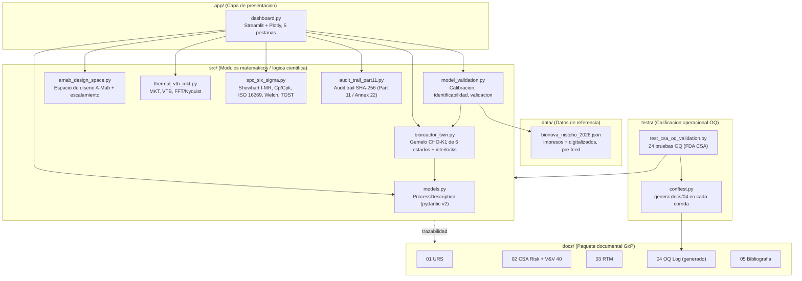

 [](https://bioprocesos-project.streamlit.app/)

# bioprocesos-PROJECT

**🌐 Live Interactive SCADA & GxP Dashboard:** [https://bioprocesos-project.streamlit.app/](https://bioprocesos-project.streamlit.app/)

Portafolio de bioprocesos, control y validacion GxP de Alejandro Timaran, estudiante de **Ingenieria Biologica** de la **Universidad Nacional de Colombia (UNAL)**, perteneciente a ISPE.

## Descripcion ejecutiva

Este repositorio reune un conjunto de modulos cientificos en Python que modelan y validan, de extremo a extremo, un sistema de control de biorreactor para cultivo de celulas CHO-K1, siguiendo marcos regulatorios reales (FDA CSA 2026, ISPE GAMP 5, ASME V&V 40, ICH Q8-Q12, 21 CFR Part 11, EU GMP Annex 11/22, ASME BPE-2014, ISO 16269-6, USP). El portafolio integra:

- Un **gemelo digital mecanistico** fed-batch CHO-K1 de 6 estados (celulas viables y muertas, glucosa, lactato, amonio, titulo) mas el volumen, **calibrado contra Bionova NISTCHO (2026)** y validado fuera de muestra, con receta estatica, protocolo Bionova y lazo cerrado adaptativo (Ark Biotech 2026).
- La evaluacion del **espacio de diseno multivariado A-Mab** (ISPE 2009) y el escalamiento de transferencia de oxigeno (kLa, OUR, enriquecimiento con O2) con el kLa medido por escala de A-Mab Tabla 3.22 (2 L a 25,000 L); por debajo de 2 L (0.25 L de Bionova) el gemelo usa 10 h^-1 del modelo estandar de 2 L como proxy (supuesto de modelado).
- Analitica termica de cadena de frio: **MKT**, **buffer termico virtual (VTB)** y verificacion de muestreo por **FFT/Nyquist** (Rusnack, Pharm. Eng. 2026).
- Control estadistico de procesos **Six Sigma** (cartas de Shewhart con estabilidad I-MR, capacidad Cp/Cpk, intervalos de tolerancia ISO 16269, prueba t de Welch y equivalencia formal TOST + Levene) sobre los datasets de Gorsky (2020).
- Una **traza de auditoria encadenada por SHA-256** conforme a 21 CFR Part 11 y al guardarail humano-en-el-lazo del EU GMP Annex 22.

Todo esto se expone en un **tablero interactivo de Streamlit + Plotly** (`app/dashboard.py`) con 5 pestanas, respaldado por una **suite de calificacion operacional (OQ)** en pytest que genera automaticamente un log de ejecucion GxP.

## Arquitectura



## Modulos matematicos (src/)

| Modulo | Responsabilidad |
| --- | --- |
| `models.py` | Esquema `ProcessDescription` (pydantic v2) con los parametros criticos del proceso (CPP), sus limites de validacion de entrada y validadores cruzados (disparo de glucosa < objetivo; cambio termico <= duracion): volumen, llenado inicial, P/V, sparge, temperaturas, dia de cambio termico, pH, DO, enriquecimiento con O2, umbrales de glucosa, duracion, modo binario (`static` / `closed_loop`) y `glucose_feedback_in_static` (regla de glucosa en la receta estatica; el protocolo Bionova es `static` con la bandera). |
| `bioreactor_twin.py` | Gemelo digital mecanistico CHO-K1 fed-batch: `simulate_cho_fed_batch` (Xv, Xd, glucosa, lactato, NH3, titulo y V(t); RK45 con respaldo Radau; `daily_pre_feed`), `compute_dissolved_oxygen_state` (DO real con enriquecimiento de O2), `compute_hydrodynamic_stress`, constantes calibradas documentadas, controlador split-range de pH `compute_split_range_ph_actuators`, programa de cambio termico `get_temperature_setpoint` e interlocks de seguridad `check_safety_interlocks` (cizalla hidrodinamica, CIP con velocidad ASME BPE 1.52 m/s, SIP con integral de letalidad F0). |
| `model_validation.py` | `load_bionova_reference_dataset`, `run_parameter_calibration` (`least_squares` TRF), `compute_validation_metrics` (R2, RMSE, NRMSE, error del dia 14 dentro y fuera de muestra), `compute_jacobian_identifiability` (valores singulares, cond(J), pares colineales), `compare_calibration_variants` (variantes A, B9_base y B9_causal de la auditoria con su regla de adopcion), `run_multistart_calibration` (convergencia desde varios arranques), `profile_mu_max_34_0` (perfil de verosimilitud), `shift_day_sweep` (barrido del dia de cambio) y `check_numerical_convergence` (ASME V&V 40). |
| `amab_design_space.py` | `evaluate_amab_design_space`: superficies de respuesta de las 4 CQA de N-glicano (z1..z4) y verificacion del espacio de diseno A-Mab; `compute_scale_up_engineering`: kLa (medido por escala o correlacion), OTR y OUR con fraccion molar de O2 del gas (`o2_mole_fraction`, por defecto aire); `AMAB_MEASURED_KLA_H_INV` y `measured_kla_for_volume`: kLa medido de A-Mab Tabla 3.22. |
| `thermal_vtb_mkt.py` | `calculate_mkt_celsius` (temperatura cinetica media, Arrhenius), `apply_vtb_filter` (buffer termico virtual de primer orden por volumen) y `analyze_fft_nyquist` (limite de Nyquist, frecuencia dominante, riesgo de aliasing). Incluye `VTB_CALIBRATION_TABLE` (con nota sobre la anomalia fisica del rotulo "300 mL (Bulk)"). |
| `spc_six_sigma.py` | `compute_process_capability` (Cp/Cpu/Cpl/Cpk, UCL/LCL, regla 1 de Shewhart, `in_statistical_control`, `capability_assumptions_met`), `compute_iso16269_tolerance_interval` (intervalo de tolerancia ISO 16269-6), `compare_bioreactor_equivalence_ttest` (prueba t de Welch) y `compare_bioreactor_equivalence_tost` (TOST de Schuirmann + Levene). Datasets de torque de Gorsky (`GORSKY_TABLE_6_1_TORQUE_N10`, `GORSKY_TABLE_6_2_TORQUE_N30`). |
| `audit_trail_part11.py` | `AuditTrailLogger`: traza de auditoria encadenada por SHA-256 a prueba de manipulacion, con aprobacion humana obligatoria (Annex 22) y razon de cambio documentada (Part 11); `verify_chain_integrity` detecta cualquier alteracion. |

## Documentos GxP (docs/)

| Documento | Descripcion |
| --- | --- |
| `docs/01_URS_Bioreactor_Control_System.md` | Especificacion de requisitos de usuario (URS-01 a URS-16, NFR-01 a NFR-07) del sistema de control del biorreactor. |
| `docs/02_FDA_CSA_Risk_Assessment_2026.md` | Evaluacion de riesgo bajo la guia FDA Computer Software Assurance (CSA) 2026 y credibilidad del modelo segun ASME V&V 40 (seccion 9). |
| `docs/03_RTM_Traceability_Matrix.md` | Matriz de trazabilidad de requisitos (RTM) que vincula URS, riesgo y pruebas, con la evidencia de calibracion y validacion (seccion 11). |
| `docs/04_Automated_OQ_Execution_Log.md` | Log de ejecucion de la calificacion operacional (OQ). **Generado automaticamente** por `tests/conftest.py` en cada corrida de pytest. |
| `docs/05_Academic_and_Regulatory_Bibliography.md` | Bibliografia academica, industrial y regulatoria de la cual se basa este repositorio. |

Nota: docs/04_Automated_OQ_Execution_Log.md se mantiene en inglés porque se regenera automáticamente en cada ejecución de pytest tests/.

Version del software: **1.4.0** (`src/__init__.py`), liberada en `main`: el tag anotado `v1.4.0` apunta al merge commit `91fb662` (PR #5). El historial de cambios esta en [`CHANGELOG.md`](CHANGELOG.md).

## Instalacion

```bash
python -m venv .venv
. .venv/bin/activate
pip install -r requirements.txt
```

## Ejecucion

Correr la suite de calificacion operacional (OQ) desde la raiz del repositorio (regenera `docs/04_Automated_OQ_Execution_Log.md`):

```bash
python -m pytest -v
```

Correr la prueba de humo del tablero (Streamlit AppTest, 17 pruebas, con `DeprecationWarning` tratado como error; no modifica el log OQ). Con las 24 pruebas OQ de `tests/`, `python -m pytest tests/ tests_app/ -v` corre 41 pruebas:

```bash
python -m pytest -v tests_app
```

La CI de GitHub Actions (`.github/workflows/csa_validation.yml`) ejecuta Python 3.11 y corre las dos suites en cada push y pull request a `main`. No se ha verificado la compatibilidad con otras versiones de Python. La CI no publica `docs/04_Automated_OQ_Execution_Log.md`: el log versionado se genera localmente al ejecutar `python -m pytest -v`, y la CI vuelve a correr las pruebas de forma independiente.

Reproducir la calibracion (fuera de linea; el tablero nunca la ejecuta) y la verificacion numerica:

```bash
python -c "from src.model_validation import run_parameter_calibration as c; r = c(); print(r['parameter_table'])"
python -c "from src.model_validation import compare_calibration_variants as c; r = c(); print(r['adopted'], r['b9_causal_criteria'])"
python -c "from src.model_validation import profile_mu_max_34_0 as p; r = p(); print(r['delta_ssr_fixed_vs_min'], r['delta_ssr_95'])"
python -c "from src.model_validation import check_numerical_convergence as c; print(c())"
```

Lanzar el tablero interactivo:

```bash
streamlit run app/dashboard.py
```

## Nota de calibracion del gemelo digital (v1.4.0)

El gemelo es un modelo mecanistico de 6 estados (Xv, Xd, G, L, NH3, titulo P) mas el volumen V, con **una sola ley cinetica** para todos los modos: `mode` solo decide la dosificacion de los bolos y nunca entra en mu, kd, qp, q_G, q_L ni q_NH3. Los resultados son **valores medidos, no forzados**.

**Ecuaciones** (T del programa 36.5 -> 34.0 C; mu_max(T) y qp(T) lineales entre 34.0 y 36.5 C):

- Crecimiento: mu = mu_max(T) * G/(K_S_G+G) * K_I_L/(K_I_L+L) * K_I_NH3/(K_I_NH3+NH3) * max(0, 1 - Xv/X_max) * f_do(DO_real).
- Muerte y lisis: kd = kd_basal + kd_starve * K_st^2/(K_st^2+G^2) + kd_NH3 * max(0, NH3 - 5 mM) + kd_hyp * max(0, (10 - DO_real)/10) + kd_shear * sigma; dXv/dt = (mu - kd) Xv; dXd/dt = kd Xv - k_lisis Xd.
- Glucosa: q_G = mu/Y_X_G + m_G * G/(K_S_G+G); dG/dt = -q_G Xv.
- Lactato (switch gobernado por el estado): produccion de desborde q_Lp = Y_L_G * mu/Y_X_G (+ efecto Pasteur bajo 15 % de DO real); consumo q_Lc = q_L,max * (1 - mu/mu_max(36.5)) * L/(K_L+L) * f_do. Mientras las celulas crecen rapido el lactato se acumula; cuando mu cae (densidad, NH3, temperatura) el consumo se libera y el lactato se reconsume. El pico aparece el dia 5 aunque el cambio termico se mueva al dia 10 o 14.
- Amonio: dNH3/dt = q_NH3 Xv; inhibe el crecimiento (K_I_NH3 = 20 mM) y suma muerte por encima de 5 mM, lo que produce la caida de viabilidad de los dias 10-14 y a 21 d.
- Titulo: dP/dt = qp(T) / (1 + k_p_NH3 * max(0, NH3 - 5 mM)^2) * f_do / (1 + alpha * sigma) * Xv, con k_p_NH3 = 0 en la calibracion adoptada (B9_base). El ajuste da qp(36.5 C) = 0.01486 > qp(34.0 C) = 0.00900 g/(1e9 cel*d). **Confusion causal documentada:** en NISTCHO (Bionova, Fig. 4) el titulo por IVCD es 0.0118 g/(1e9 cel*d) en los dias 0-8 y todavia 0.0108 en los dias 8-10, ya a 34 C; cae a 0.0084 (dias 10-12) y 0.0028 (dias 12-14) cuando el NH3 llega a 10.2-10.5 mM. La desaceleracion sigue a la edad del cultivo y al NH3, no al escalon de 34 C, pero con una sola corrida y un solo dia de cambio las dos anclas de temperatura son el unico termino que puede absorberla. Por eso el gemelo no debe usarse para elegir el dia de cambio (ver el barrido abajo).
- Oxigeno: el controlador sostiene el set-point enriqueciendo el gas con O2 (hasta `max_o2_mole_fraction`); el DO real del liquido es C_L = min(C_sp, max(0, C*_max - OUR/kLa)). La biologia depende solo del DO real: f_do = 1.0 desde 15 %, Pasteur bajo 15 % y muerte hipoxica bajo 10 %. La saturacion del controlador no es hipoxia por si misma.
- Cizalla: la alarma (P/V > 47.6 W/m3 **OR** sparge > 0.15 vvm) no cambia la cinetica. En las ecuaciones solo actua el burbujeo por encima de 0.15 vvm; el impulsor solo penaliza por encima de 476 W/m3, fuera del rango del esquema (P/V <= 100 W/m3).
- Volumen y bolos: V0 = `initial_fill_fraction` * V (0.70 por defecto; 0.76 en el protocolo Bionova). Bolos de 4.62 % de V0 los dias 2-12 (x1.80 y x1.82 de Ark en closed_loop los dias 8 y 10), regla pre-feed de glucosa < 2 -> 5 g/L en closed_loop y en static con `glucose_feedback_in_static` (el protocolo Bionova), sin bolo el dia de cosecha (6 bolos en 14 d), balance de masa exacto de las 6 especies y recorte por capacidad (`bolus_clipped_alarm`).
- Numerica: integracion por tramos entre eventos con `solve_ivp` RK45 (rtol 1e-6, atol 1e-9) y respaldo automatico Radau; 8.5 ms por corrida de 14 d.

**Parametros calibrados** (variante B9_base de la auditoria del Draft PR #5; Bionova Stratyx 30 W/m3, 60 puntos pre-feed, `least_squares` TRF; detalle, RSE y colinealidad en docs/03, seccion 11):

| Parametro | Valor | Cotas | Estado | Identificable |
| --- | --- | --- | --- | --- |
| mu_max(36.5 C) | 0.8022 1/d | [0.65, 0.95] | interior | Si (RSE 3.0 %) |
| G_BOOST_CONC | 82.22 g/L | [55, 85] | interior | Si (7.8 %) |
| X_max | 38.14e6 cel/mL | [20, 60] | interior | Si (7.1 %) |
| q_L,max | 0.3044 g/(1e9 cel*d) | [0, 1] | interior | Si (7.8 %) |
| q_NH3 | 0.0584 mmol/(1e9 cel*d) | [0, 0.3] | interior | Si (6.2 %) |
| kd_NH3 | 0.0167 1/(d*mM) | [0, 0.2] | interior | Si (23.9 %) |
| qp(36.5 C) | 0.01486 g/(1e9 cel*d) | [0, 0.05] | interior | Si (13.8 %) |
| qp(34.0 C) | 0.00900 g/(1e9 cel*d) | [0, 0.05] | interior | Si (10.6 %) |
| m_G | 0.0610 g/(1e9 cel*d) | [0.03, 0.25] | interior | Si (17.1 %) |

cond(J) = 28.5; ningun par con abs(r) > 0.90 (el maximo es 0.886, G_BOOST_CONC con m_G). El prior documentado y 8 arranques aleatorios llegan al mismo optimo (dispersion de SSR 3e-8).

**Fijados por la auditoria** (literatura; la corrida unica de Bionova no los identifica):

- K_I_L = 10.0 g/L: punto medio del rango CHO de literatura de 5-15 g/L (cotas de la especificacion v1.4.0). El lactato de Bionova no pasa de 1.4 g/L; libre, K_I_L llegaba a la cota de 5 g/L (RSE 65.5 %, abs(r) hasta 0.979 con mu_max(36.5), cond(J) 398.8).
- mu_max(34.0) = 0.35 1/d: extremo superior del rango de la especificacion [0.10, 0.35], 44 % de mu_max(36.5) (hipotermia leve). El perfil de verosimilitud es plano por encima de 0.35: la SSR baja solo 2.94 hasta su minimo cerca de 1.50 1/d, menos que chi2(1, 0.95) = 3.84 con las incertidumbres declaradas, asi que los datos no lo acotan por arriba. Libre (con K_I_L = 10), llegaba a toda cota superior probada (0.35, 0.55 y 1.50).

Fijos (no calibrados): K_S_G 0.5 g/L, K_I_NH3 20 mM, umbral NH3 5 mM, Y_X_G 3.0e9 cel/g, Y_L_G 0.80 g/g, K_L 0.30 g/L, kd_basal 0.03 1/d, k_lisis 1.0 1/d, kd_starve 0.5 1/d (K_st 0.1 g/L), kd_hyp 0.1 1/d, fraccion Pasteur 0.8, kd_shear 0.03 1/d, alpha_shear 1.0, k_p_NH3 0.

**Validacion contra Bionova** (criterio de credibilidad: RMSE <= 2 x incertidumbre declarada):

| Condicion | VCD | Viabilidad | Glucosa | Lactato | NH3 | Titulo |
| --- | --- | --- | --- | --- | --- | --- |
| 30 W/m3, dentro de muestra: R2 / RMSE | 0.981 / 1.16 | 0.707 / 1.25 % | 0.890 / 0.68 g/L | 0.827 / 0.169 g/L | 0.918 / 0.97 mM | 0.949 / 0.093 g/L |
| 30 W/m3, error dia 14 | +0.73 | -1.80 pp | -0.67 g/L | -0.30 g/L | +1.16 mM | +0.101 g/L (+5.3 %) |
| 19 W/m3, fuera de muestra | R2 0.784, RMSE 2.57 (1.71 sigma) | dia 14: -2.25 pp | sin datos | pico -0.001 g/L (dia 5); dia 14 -0.18 g/L | dia 14 +1.16 mM | dia 14 +0.117 g/L (+6.2 %) |

Todas las variables cumplen el criterio (maximo 1.71 sigma). Con la glucosa calibrada, el protocolo Bionova dispara la regla 2 -> 5 g/L por si solo el dia 12 (G pre-feed 1.76 g/L; repone 0.16 mL de stock de 500 g/L).

**Seleccion de la calibracion en la auditoria** (`compare_calibration_variants`; detalle en docs/03, seccion 11.1):

| | A (primer candidato) | B9_base (adoptado) | B9_causal |
| --- | --- | --- | --- |
| Parametros libres | 10: K_I_L y mu_max(34) libres, m_G = 0.05 | 9: K_I_L = 10 y mu_max(34) = 0.35 fijos, m_G libre | 9: como B9_base, con qp sin efecto de T e inhibido por NH3 |
| SSR ponderada | 68.81 | 70.68 | 65.76 |
| cond(J) | 398.8 | 28.5 | 72.7 |
| Pares con abs(r) > 0.90 | 6 | 0 | 0 |
| Parametros en cota | K_I_L NEAR_BOUND | ninguno | ninguno (k_p_NH3 con RSE 64 %) |
| RMSE de titulo a 30 W/m3 (g/L) | 0.094 | 0.093 | 0.027 |
| G pre-feed minima en Bionova | 2.007 g/L: no repone | 1.757 g/L: repone el dia 12 | 1.757 g/L: repone el dia 12 |
| Titulo sin cambio (dia 14) frente al dia 7 | +73.6 % | +65.3 % | +4.8 % |

Regla de la auditoria: B9_causal se adopta solo si sus 9 parametros quedan en el interior, cond(J) < 60 sin pares con abs(r) > 0.90, todo RMSE <= 2 sigma con un RMSE de titulo no peor que el de B9_base, y el protocolo Bionova repone glucosa por si solo. B9_causal cumple todo salvo cond(J): k_p_NH3 queda mal determinado con 4 puntos de titulo. Por eso el codigo adopta B9_base y documenta la confusion causal T/edad de qp(T). A no tenia un optimo unico: desde 9 arranques da SSR de 68.25 a 70.55 con K_I_L entre 5.0 y 8.1.

**Barrido del dia de cambio termico** (protocolo Bionova; solo el dia 7 tiene datos):

| Dia de cambio | VCD pico | Viabilidad final (%) | NH3 final (mM) | Titulo B9_base (g/L) | Masa B9_base (g) | Titulo B9_causal (g/L) |
| --- | --- | --- | --- | --- | --- | --- |
| 4 | 20.37 | 92.66 | 9.14 | 1.4050 | 0.3409 | 1.6997 |
| 7 | 23.70 | 88.75 | 11.66 | 1.9973 | 0.4850 | 1.9168 |
| 10 | 28.82 | 87.02 | 12.82 | 2.5870 | 0.6308 | 1.9803 |
| 14 (sin cambio) | 28.83 | 86.32 | 13.37 | 3.3024 | 0.8067 | 2.0084 |

Las columnas de VCD, viabilidad y NH3 son de B9_base (B9_causal difiere en menos de 0.2). Con B9_base el titulo sube con el dia de cambio: sin cambio da +65.3 % frente al dia 7. Es un artefacto de la confusion T/edad de qp(T), no una prediccion, e invierte A-Mab Tabla 3.12 (p. 73), donde la temperatura mas baja dio mayor productividad especifica, un cultivo mas largo y mayor titulo. B9_causal reduce esa diferencia a +4.8 %.

Limitaciones que se reportan sin ajustar ecuaciones: K_I_L y mu_max(34.0) fijos por falta de identificabilidad; la confusion T/edad de qp(T); lactato tardio bajo (0.02 frente a 0.2-0.3 g/L); el modelo repone glucosa solo el dia 12, mientras que en Bionova la glucosa pre-feed de los dias 10 y 12 (1.2 y 1.9 g/L) queda bajo el disparo; sin efecto de P/V entre 19 y 30 W/m3 (a 19 W/m3 el modelo sobrestima la VCD tardia).

Trabajo futuro (v1.5.0, decision de la auditoria): un retardo tau_T de la respuesta del ciclo celular a la temperatura, con el diseno experimental que lo identifica: corridas con cambio temprano (dias 3-4) y pulsos de lactato de 2-6 g/L.

**Receta estatica frente a lazo cerrado** (2.0 L, DO 30 %, enriquecimiento con O2; concentraciones identicas a 0.25 L):

| Duracion | Modo | Titulo (g/L) | Viabilidad (%) | VCD pico | NH3 final (mM) | Masa (g) | Feed (L) |
| --- | --- | --- | --- | --- | --- | --- | --- |
| 14 d | static | 1.9982 | 88.70 | 23.70 | 11.66 | 3.5729 | 0.3881 |
| 14 d | closed_loop | 1.9319 | 89.45 | 23.44 | 11.30 | 3.6567 | 0.4929 |
| 21 d | static | 2.4548 | 35.03 | 23.70 | 14.62 | 4.3894 | 0.3881 |
| 21 d | closed_loop | 2.6879 | 38.01 | 23.44 | 16.21 | 5.0878 | 0.4929 |

- A 14 d el lazo cerrado **no supera** a la receta estatica en g/L (-3.32 %): la glucosa no se agota en ningun modo (minimo 1.27 g/L en static) y los bolos extra de Ark diluyen el titulo. Cosecha +2.35 % de masa y gana +0.75 puntos de viabilidad (menos NH3). A 21 d, sin alimentacion despues del dia 12, la glucosa extra retrasa el agotamiento: +9.50 % en g/L y +15.91 % de masa. El gemelo no tiene aminoacidos ni otros nutrientes que esos bolos podrian aportar, por eso no reproduce el +43 % de Ark (dato de literatura).
- A 21 d la viabilidad cae a 35-38 % (agotamiento de glucosa y NH3 > 5 mM): no hay inmortalidad sintetica.

**Respuesta al setpoint de DO** (closed_loop, 2.0 L, kLa 10 h^-1):

| DO (%) | Enriquecimiento O2 | Titulo (g/L) | VCD pico | Pico L (g/L) | DO real min (%) | f_do min | Controlador saturado |
| --- | --- | --- | --- | --- | --- | --- | --- |
| 5 | Si | 0.9763 | 14.84 | 1.741 | 5.00 | 0.846 | No |
| 30 | Si | 1.9319 | 23.44 | 1.449 | 30.00 | 1.000 | No |
| 85 | Si | 1.9319 | 23.44 | 1.449 | 85.00 | 1.000 | No |
| 30 | No (solo aire) | 1.6553 | 20.19 | 1.449 | 3.89 | 0.794 | Si |
| 85 | No (solo aire) | 1.6553 | 20.19 | 1.449 | 3.89 | 0.794 | Si |

- Con enriquecimiento el controlador sostiene 30 y 85 % sin saturarse (y_O2 requerido maximo 0.296 y 0.411) y la biologia es identica: no hay hipoxia falsa.
- Solo con aire, a DO 85 % el controlador se satura desde el dia 2.5 y el DO real pasa por 55-75 % (dias 3.4-4.6) con f_do = 1.0. La hipoxia real aparece el dia 6.6, cuando Xv (18.20e6 cel/mL) supera 17.85e6 cel/mL, el limite fisico de transferencia con aire a kLa 10 h^-1 (antes de v1.4.0, DO_eff = DO * ratio penalizaba dos veces y fijaba un techo artificial de 14.7e6 cel/mL a DO 30 %).
- A DO 5 % la hipoxia es real (f_do 0.846, efecto Pasteur, muerte hipoxica) y el titulo baja 49 %. Los parametros de hipoxia son supuestos no calibrados.
- El slider de DO del tablero cubre 5-90 %; su minimo se lee del limite de validacion de `ProcessDescription` (5-100 %).

**Verificacion numerica:** RK45 (1e-6) frente a RK45 y Radau (1e-9): error maximo 1.94e-6; el Euler de v1.3.2 (dt 0.1 d) tenia 1.04e-1. Barrido de 256 esquinas de los sliders (DO 5-90 %): sin NaN/Inf ni valores negativos, 4.4 ms de media y 13.8 ms de maximo. Sensibilidad direccional verificada: sparge 0.25 frente a 0.10 vvm baja titulo y viabilidad, 21 frente a 14 d sube NH3 y baja viabilidad, y enfriar el dia 4 frente al dia 10 baja la VCD pico. La prueba tambien fija la limitacion documentada: con qp(36.5) > qp(34.0) el titulo sube con el dia de cambio.

**Escalamiento (pestana 2):** los presets son las columnas de A-Mab Tabla 3.22 y usan su kLa medido (2 L 10, 500 L 8, 1,000 L 10, 5,000 L 10, 15,000 L 20, 25,000 L Future 20 h^-1). Con aire, a VCC 15e6 cel/mL y DO 30 % el OTR es 1.47 / 1.18 / 1.47 / 1.47 / 2.94 / 2.94 mmol/L/h frente a OUR 1.50, asi que 2, 500, 1,000 y 5,000 L muestran el aviso de oxigeno del modelo, que ahora indica tambien el OTR con O2 puro. En 15,000 L la correlacion (Vs = 0.015 m/s, P/V = 26 W/m3) y el valor medido coinciden en **20.00 h^-1** (**OTR = 2.94 mmol/L/h** con DO = 30 %).

**Six Sigma** (Gorsky Tabla 6.2, n=30, lb/in; unidad impresa asi en Gorsky, Tabla 6-2; dimensionalmente un torque se expresaria en lbf·in, observacion del repo, no de la fuente): **Ppk 0.51**, **Cpk(within) 0.43**, **Shapiro-Wilk p = 0.243**, **0 puntos fuera de control** (regla 1 I-MR, supuestos de capacidad cumplidos); intervalo de tolerancia ISO 16269-6 (Tabla 6.1, n=10, kp) con **k_factor 3.394**. La pestana 4 incluye TOST + Levene editable.

**Calificacion operacional:** **24/24 pruebas OQ** y 17/17 pruebas de humo del tablero.

Las paginas de A-Mab v2.1 que cita el repo para el espacio de diseno (pp. 90-92 y 100-106) respaldan las ecuaciones de N-glicanos (`evaluate_amab_design_space`), no la cinetica del gemelo. Para transferencia de oxigeno el repo cita A-Mab Ec. 4 (p.101), Fig. 3.11 (p.102), Fig. 3.12 (enriquecimiento con O2) y Tabla 3.22.

## Seccion 5: Bibliografia Academica, Industrial y Regulatoria
Referencias Bibliográficas y Marco Regulatorio (References)

A. Modelamiento de Bioprocesos, Escalamiento, QbD y Gemelos Digitales
1. CMC Biotech Working Group (Pfizer, Amgen, Genentech, Eli Lilly, GSK, Abbott, MedImmune), A-Mab: A Case Study in Bioprocess Development, Version 2.1, CASSS and International Society for Pharmaceutical Engineering (ISPE), Oct. 2009.
2. R. Kulkarni, C. Horner, J.-M. Guedon, Y. Zahra, C. Edington, and M. Aswath, "STRATYX™ Delivers Superior Viable Cell Density and Increased mAb Titer Compared with Conventional 250 mL Bioreactors in Fed-Batch CHO Culture," Culture Biosciences & Bionova Scientific Whitepaper, 2026.
3. Y. Quint, H. Worssam, C. Horner, and M. Khor, "Real-Time Closed-Loop Optimization Delivers 43% Titer Improvement Over Historical Best," Ark Biotech & Culture Biosciences Technical Bulletin, 2026.
4. H. Dahodwala et al., "Development and Characterization of the NISTCHO Reference Cell Line," Biotechnology Journal, vol. 20, no. 5, e70012, May 2025, doi: 10.1002/biot.70012.
5. D. M. Marks, "Best Practices for Bioreactor Contamination Investigations," Pharmaceutical Engineering (ISPE), vol. 46, no. 5, pp. 67–71, Sep./Oct. 2026.
6. N. K. Ma et al., "Fabrication and use of a transient contraction flow device to quantify the sensitivity of mammalian and insect cells to hydrodynamic forces," Biotechnology and Bioengineering, vol. 80, pp. 428–436, 2002.
7. V. Warikoo et al., "Integrated continuous production of recombinant therapeutic proteins," Biotechnology and Bioengineering, vol. 109, no. 12, pp. 3018–3029, 2012.
8. M.-F. Clincke et al., "Very high density of CHO cells in perfusion by alternating tangential flow or tangential flow filtration in wave bioreactor™—Part I: Effect of the cell density on the process," Biotechnology Progress, vol. 29, no. 3, 2013.

B. Estadística de Validación de Procesos, Seis Sigma y Confiabilidad Bayesiana

9. I. Gorsky, "Chapter 6: Use of Statistics in Process Validation," in Principles of Parenteral Solution Validation, Elsevier Inc., 2020, pp. 115–136, doi: 10.1016/B978-0-12-809412-9.00005-8.
10. J. J. Peterson, "A Bayesian Approach to the ICH Q8 Definition of Design Space," Journal of Biopharmaceutical Statistics, vol. 18, no. 5, pp. 959–975, 2008.
11. G. C. Stockdale and A. Cheng, "Finding design space and a reliable operating region using a multivariate Bayesian approach with experimental design," Quality Technology and Quantitative Management, vol. 6, no. 4, pp. 391–408, 2009.
12. ISO 16269-6:2014, Statistical interpretation of data — Part 6: Determination of statistical tolerance intervals, International Organization for Standardization, Geneva, 2014.
13. ASTM E2281, Standard Practice for Process and Measurement Capability Indices, ASTM International, West Conshohocken, PA.

C. Termodinámica de Cadena de Frío, MKT, Procesamiento de Señales y Calidad 4.0

14. M. Rusnack, "Quantifying the Limitations of Fixed Physical Temperature Buffers," Pharmaceutical Engineering (ISPE), vol. 46, no. 5, pp. 54–66, Sep./Oct. 2026. Datasets: Zenodo, doi: 10.5281/zenodo.15871349 and doi: 10.5281/zenodo.20788524.
15. R. Dream, "Quality 4.0: Part 1 — Quality Management Principles and Benefits," Pharmaceutical Engineering (ISPE), vol. 46, no. 5, pp. 12–17, Sep./Oct. 2026.
16. G. Kantor, "Effective Sampling in Pharmaceutical Utility Systems (ISPE Good Practice Guide & USP <1231>)," Pharmaceutical Engineering (ISPE), vol. 46, no. 5, p. 47, Sep./Oct. 2026.

D. Guías Regulatorias, Validación de Sistemas Computarizados (CSA/GAMP 5) y Diseño Higiénico

17. U.S. Food and Drug Administration (FDA), Computer Software Assurance for Production and Quality Management System Software: Guidance for Industry and Food and Drug Administration Staff, CDRH/CBER/CDER, Feb. 3, 2026.
18. ISPE, GAMP® 5 Guide: A Risk-Based Approach to Compliant GxP Computerized Systems, 2nd ed., North Bethesda, MD: International Society for Pharmaceutical Engineering, 2022; and ISPE Baseline® Guide, Vol. 8: Pharma 4.0™, 2023.
19. ASME BPE-2014, Bioprocessing Equipment: An International Standard, The American Society of Mechanical Engineers, New York, NY, 2014.
20. European Commission / EMA & FDA, EudraLex Volume 4, Annex 11 (Computerized Systems) & Draft Annex 22 (Artificial Intelligence); ICH Harmonised Guidelines Q8(R2), Q9(R1), Q10, Q11, Q12; and Ministerio de Salud y Protección Social de Colombia, Decreto 1782 de 2014 (evaluación farmacológica y farmacéutica de medicamentos biológicos) y Resolución 1160 de 2016 (BPM Farmacéuticas / OMS Informes Técnicos 37 y 45).

E. Credibilidad de Modelos Computacionales (añadida en v1.4.0)

21. ASME V&V 40-2018, Assessing Credibility of Computational Modeling through Verification and Validation: Application to Medical Devices, The American Society of Mechanical Engineers, New York, NY, 2018.
